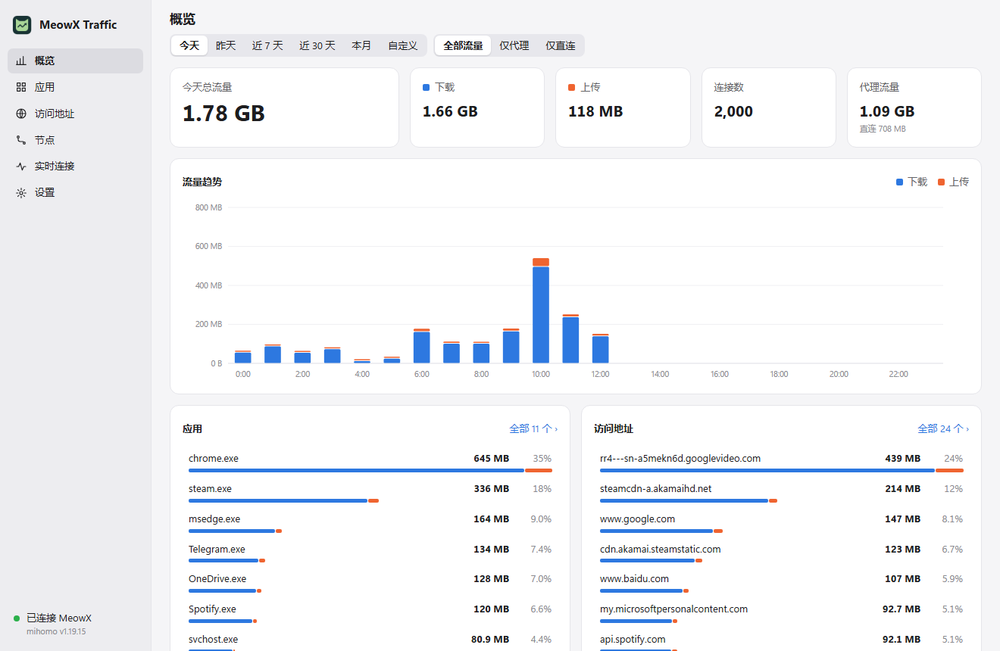
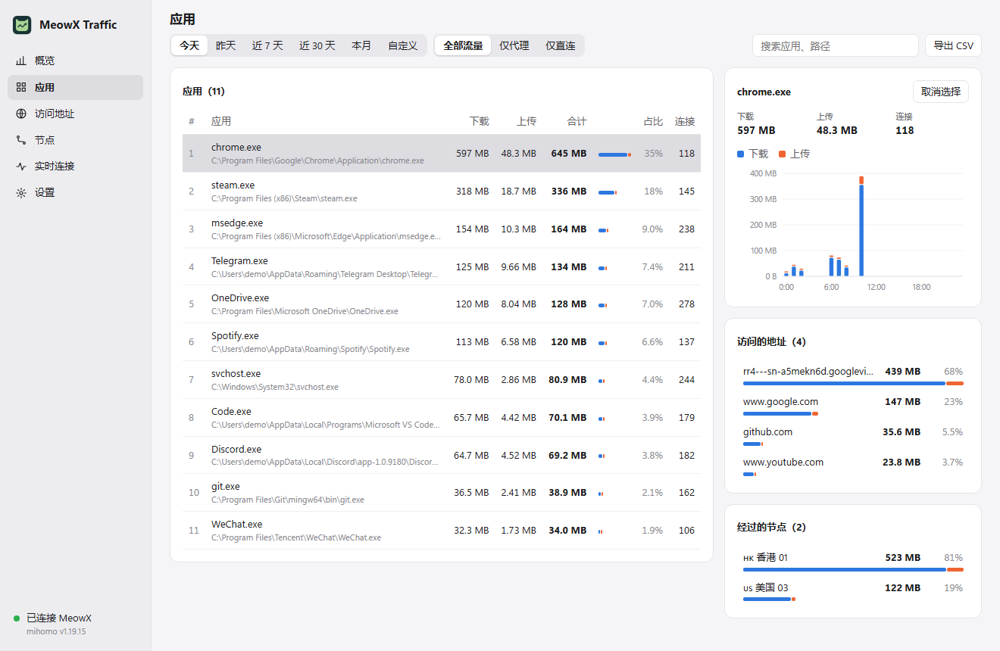
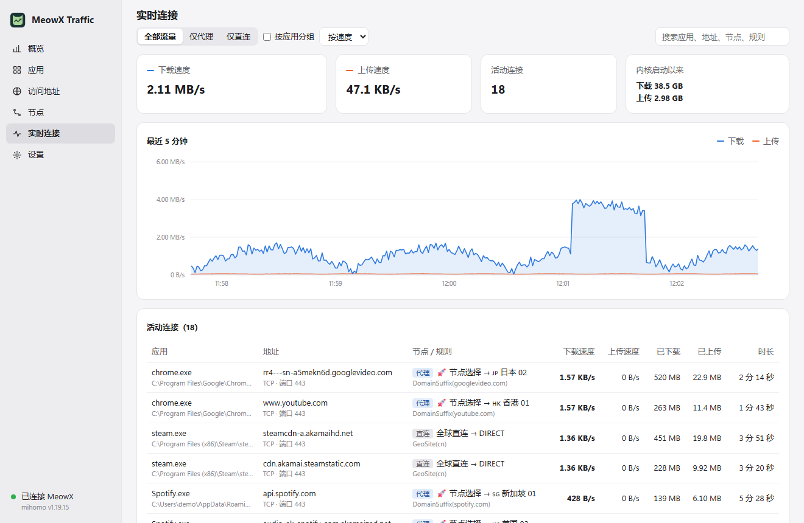
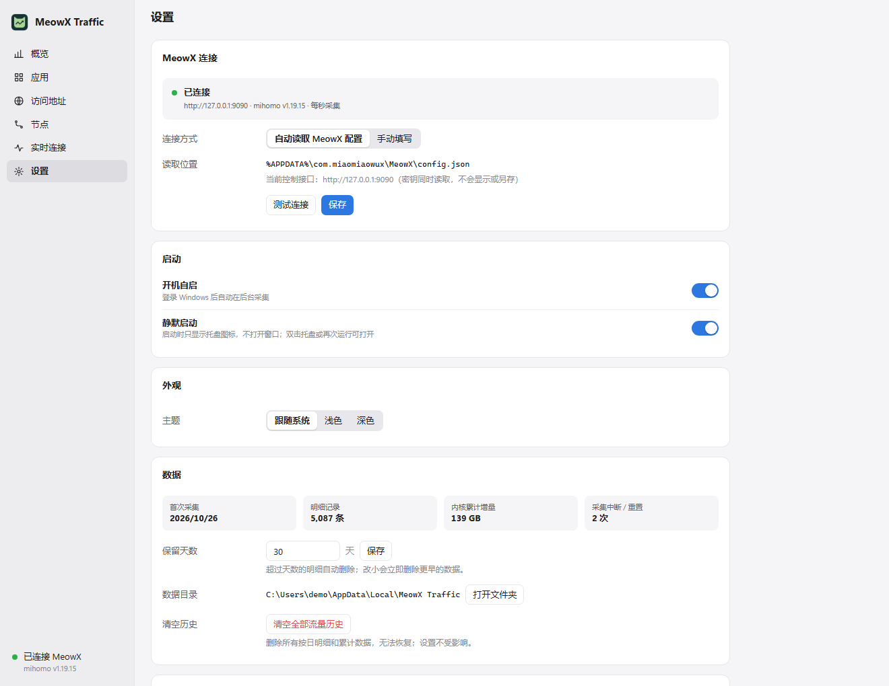
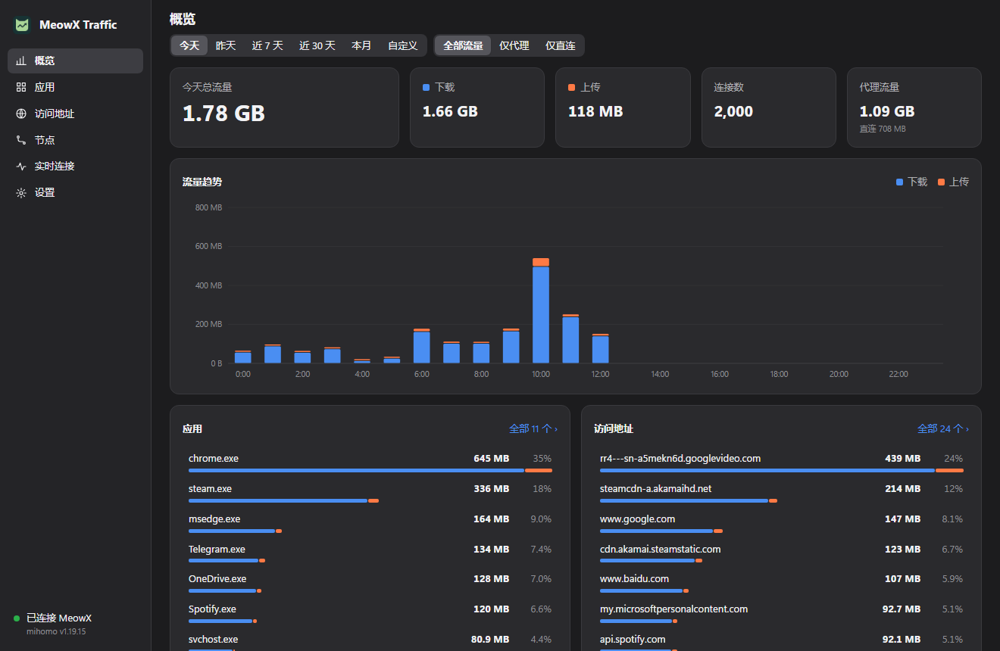

<div align="center">


# MeowX Traffic

按应用统计 MeowX 流量的 Windows 托盘小工具：哪个软件在走代理、走了多少、经过哪个节点，一目了然。

[](https://github.com/zshpaul/meowx-traffic/releases/latest)
[](https://github.com/zshpaul/meowx-traffic/actions/workflows/ci.yml)
[](LICENSE)


</div>

> [!NOTE]
> 这是 MeowX（妙妙屋生态的桌面代理客户端）的**非官方**配套工具，与妙妙屋 / MeowX 官方无隶属关系。



<details>
<summary>更多截图（应用详情 / 实时连接 / 设置 / 深色主题）</summary>






截图使用演示数据生成。

</details>

## 为什么需要它

MeowX 的连接列表只反映当前时刻。想知道“这周走代理的流量是谁用掉的”“Obsidian 同步到底是直连还是代理”，需要一个长期记账的工具。MeowX Traffic 通过 MeowX 本机控制接口每秒采样一次连接，按应用、访问地址、节点和小时累计，保存在本机。

- 不修改 MeowX、不修改代理规则，只读控制接口。
- 数据只存在本机，不上传任何地方。
- 单个 exe，关窗后在托盘继续采集，默认开机静默启动。

## 功能

| 页面 | 内容 |
| --- | --- |
| 概览 | 总流量、上下行、连接数、代理 / 直连占比；按小时或按天的趋势；应用、地址、节点排行 |
| 应用 / 访问地址 / 节点 | 排行表格，点选一行查看其趋势及关联的地址、应用、节点；搜索、导出 CSV |
| 实时连接 | 上下行速度、最近 5 分钟曲线、活动连接的节点链、命中规则和时长；可按应用分组 |
| 设置 | 连接方式与测试连接、开机自启、静默启动、主题、保留天数、数据目录、清空历史 |

统计页支持今天 / 昨天 / 近 7 天 / 近 30 天 / 本月 / 自定义日期，以及全部 / 仅代理 / 仅直连过滤。

## 快速开始

**1. 准备 MeowX**

MeowX 需要开启本机控制接口，并让内核识别每个连接所属的进程。对应 `%APPDATA%\com.miaomiaowux\MeowX\config.json` 中 `patchClashConfig` 的这几项：

```json
"external-controller": "127.0.0.1:9090",
"secret": "换成你自己的随机字符串",
"find-process-mode": "always"
```

`external-controller` 是控制接口，不是 7890 代理端口；`find-process-mode: always` 是按应用统计的前提。修改后重启 MeowX。

**2. 安装**

1. 从 [Releases](https://github.com/zshpaul/meowx-traffic/releases/latest) 下载 `MeowX-Traffic-<版本>-windows-x64.zip` 并解压。
2. 右键 `Install.ps1` → 使用 PowerShell 运行。程序复制到 `%LOCALAPPDATA%\Programs\MeowX Traffic`，创建开始菜单入口，并为当前用户开启登录自启（无需管理员）。
3. 从开始菜单或托盘图标打开窗口。也可以不安装，直接双击 exe 便携使用。

程序默认自动读取上述 MeowX 配置获取接口地址和密钥；密钥不会复制到本工具的数据文件、不返回前端、不写日志。配置不在默认位置时，在「设置 → MeowX 连接」改为手动填写。MeowX 未运行时会持续重试，两者启动先后不限。

需要 Windows 10/11 x64 和 Microsoft Edge WebView2 Runtime（Windows 11 自带）。

## 在另一台电脑使用

每台电脑独立安装、独立统计：下载同一个发布包按上述步骤安装，并在该电脑的 MeowX 中设置**它自己的** secret。不要复制其他电脑的 MeowX 配置、密钥或流量历史；各电脑数据不会自动合并。

## 升级与卸载

- 升级：托盘右键 → 退出，再运行新版的 `Install.ps1`。历史数据独立保存，不会被覆盖。
- 卸载：托盘关闭开机自启 → 退出，删除 `%LOCALAPPDATA%\Programs\MeowX Traffic` 和开始菜单快捷方式。历史在 `%LOCALAPPDATA%\MeowX Traffic`，需要时手动删除。

## 数据与统计边界

- 数据：`%LOCALAPPDATA%\MeowX Traffic\history.json`（每 5 秒保存，退出时再保存）和 `settings.json`。明细默认保留 30 天，可设 1–3650 天。
- 只统计经过 MeowX 内核的流量；未经过它的系统流量看不到。
- 每次启动或中断超过 10 秒后重新建立基线，不追记中断期间的数据；极短的连接可能漏采。
- 无法归属到连接的内核增量不会被猜测分配给某个应用。
- 应用按原始进程名归类，不合并 WebView2、Node 等辅助进程。
- 看不到 HTTPS 内容的具体文件路径，也无法恢复首次运行之前的流量。

## 工作原理

与 [Clash Traffic](https://github.com/lufficc/clash-traffic) 思路相同：轮询 mihomo 内核的 `/connections`，对每条连接的累计上传 / 下载做差分，按进程、目标地址、节点链和小时累加。分析过程和证据见 [docs/architecture.md](docs/architecture.md)。

## 构建

```powershell
go test ./...
go build -ldflags '-H windowsgui' -o 'dist\MeowX Traffic.exe' .
# 连接本机真实 MeowX 的集成测试
$env:MEOWX_LIVE_TEST = '1'; go test -v ./...
```

需要 Go 1.27+。exe 图标资源可用 [go-winres](https://github.com/tc-hib/go-winres) 由 `assets/icon.ico` 生成（`*.syso` 不入库，缺少时仍可编译，只是没有 exe 图标）。界面使用 [MyGo](https://github.com/egoist/mygo) + WebView2。

## 相关项目与致谢

- [iluobei/miaomiaowu](https://github.com/iluobei/miaomiaowu)：妙妙屋，Clash 订阅管理。
- [iluobei/miaomiaowuX](https://github.com/iluobei/miaomiaowuX)：妙妙屋 X，Xray 服务端管理；交流群 [t.me/miaomiaowux](https://t.me/miaomiaowux)。
- [lufficc/clash-traffic](https://github.com/lufficc/clash-traffic)：界面布局和统计思路的灵感来源。本项目独立编写，未复制其代码（该仓库未附许可证）。
- [egoist/mygo](https://github.com/egoist/mygo)：Go 桌面窗口与托盘。
- [MetaCubeX/mihomo](https://github.com/MetaCubeX/mihomo)：MeowX 使用的代理内核及其控制接口。

本项目只通过公开的 mihomo 控制接口与 MeowX 交互，不包含妙妙屋 / MeowX 的任何代码。

## 许可证

[MIT](LICENSE)。发布包附带依赖的许可证文本。

---

**English:** MeowX Traffic is an unofficial Windows tray companion for the MeowX proxy client. It polls the local mihomo controller (`/connections`), records per-app / per-host / per-node traffic by hour, and shows it in a Clash Traffic-style dashboard with direct/proxy filtering, custom date ranges and silent autostart. Data stays on your machine. Download from [Releases](https://github.com/zshpaul/meowx-traffic/releases/latest).
